<h1>
  <picture>
    <source media="(prefers-color-scheme: dark)" srcset="assets/compass-header-dark.svg">
    
  </picture>
</h1>

**Acceptance-test-driven development for Claude Code, with a record a reviewer can check.**

[](https://github.com/ayeo-io/compass/actions/workflows/compass.yml)
[](https://docs.ayeo.io/compass/)
[](https://github.com/ayeo-io/compass/releases)
[](LICENSE)

Compass lets a team under change control give code changes to an AI agent
and still show a reviewer or an auditor what happened. The agent proves each
change with acceptance tests. A person approves each change. Compass keeps a
record of both.

## What one change leaves

Each change leaves one plain file, `trail.md`, with six sections:

1. Who asked
2. What was agreed
3. Red, for each scenario
4. Green
5. Who approved, and by what authority
6. What shipped

Red is the test run that fails without the change. Green is the run that
passes with it. Each section names its evidence files with a SHA-256
digest, so a reviewer checks the trail without Compass installed:

```bash
grep -E '^[0-9a-f]{64}  ' .compass/work/<issue>/trail.md | sha256sum -c -
```

## Who it is for

Teams that want an agent's speed and must still show how each change was
made. ISO 27001 and SOC 2 both expect each change to be authorized and
traceable. Compass keeps the records such a process reads. This is not
checked against a specific audit.

## Install

```bash
claude plugin install compass --marketplace ayeo-io/compass
```

Or, inside Claude Code:

```text
/plugin marketplace add ayeo-io/compass
/plugin install compass@compass
```

Needs Python 3.10 or later. To install from source, or if something fails,
see [docs/install-smoke-test.md](docs/install-smoke-test.md).

## The first change

Describe the work:

```text
/compass:go "Add rate limiting to the public API"
```

The session then does four things:

1. Opens an issue with `compass quick-fix start`. This records the request
   and who asked.
2. Writes the scenarios, the tests and the code.
3. Runs `compass quick-fix finish`. This shows that the tests fail without
   the change and pass with it, then asks for your approval.
4. After you approve, commits the change and its record on a branch.

You answer in the same session:

```text
/compass:approve
/compass:reject "the criteria miss the burst case"
```

`/compass:status` shows what is blocked, moving and done.
[docs/five-minutes.md](docs/five-minutes.md) walks through one change.

The record of an issue is in `docs/compass/<created>-<issue>/` and
`.compass/work/<issue>/`. It ships in the same commit as the code.

## The rules

Compass chooses the evidence each change owes from its assessment and the
project's settings. The same inputs give the same evidence each time.

Five guardrails apply to all work that ships code:

1. A test that fails without the change.
2. Acceptance criteria before code.
3. Code traced to a criterion.
4. Typed evidence, not a written claim.
5. A person's approval for a change labeled `auth`, `payments`,
   `personal-data` or `migrations`.

`compass check` fails on a breach under enforced adoption. A project adds
its own checks and settings in `compass.yml`
([docs/configuration.md](docs/configuration.md)).

<p align="center">
  
</p>

## A person stays in control

- **A person approves each change.** You type `/compass:approve`, or you
  approve the pull request as someone other than its author. An agent
  cannot run `/compass:approve`
  ([safety contract](docs/safety-contract.md#5-irreversible-work-needs-recorded-human-approval)).
- **An approval covers what you saw.** When the code or the tests change
  afterwards, Compass asks again.
- **Sensitive work gets an earlier approval.** For a change labeled `auth`,
  `payments`, `personal-data` or `migrations`, or with critical risk, a
  person approves the scenarios before any code edit.
- **You can delegate.** `/compass:delegate` lets an agent approve for you,
  within bounds you set, until `/compass:revoke` ends it.

## What Compass does not do

- It does not show that a test was written before the code. It shows that
  the tests fail without the change ([docs/base-copy.md](docs/base-copy.md)).
- It does not check who the requester is. The session records that claim.
- It does not replace your CI: tests, linting, security scanning, builds or
  deployment checks.
- It does not stop a program that runs as your own user account.

The [safety contract](docs/safety-contract.md) lists what Compass guarantees
and what it cannot see.

## What Compass runs, sends and fetches

Compass works on your machine and in your repository. It writes nothing to
GitHub. Details: [docs/security.md](docs/security.md).

- **Runs** your test command, git, and the `project_checks` you declare in
  `compass.yml`.
- **Reads** a pull request with `gh`, when you run `compass issue link set
  --pr`.
- **Sends** the record to a git repository with `compass record sync`, only
  when `compass.yml` names one. It redacts credentials.
- **Fetches** nothing.

## Read next

- **[Five-minute walkthrough](docs/five-minutes.md):** install Compass and ship a small issue.
- **[Upgrading from 8.x](docs/upgrade-9-0-0.md):** run `compass migrate`. Compass 8.x gets security fixes only, for 90 days after 9.0.0 is released.
- **[Safety contract](docs/safety-contract.md):** what Compass guarantees and what it does not.
- **[Delivery record](docs/delivery-record.md):** what an issue records, and how to check `trail.md`.
- **[All docs](docs/README.md):** settings, GitHub links, waivers, security and the rest.
- **[Contributing](CONTRIBUTING.md):** what judges a pull request, and what the repository contains.

## License

Apache 2.0. See [LICENSE](LICENSE).
