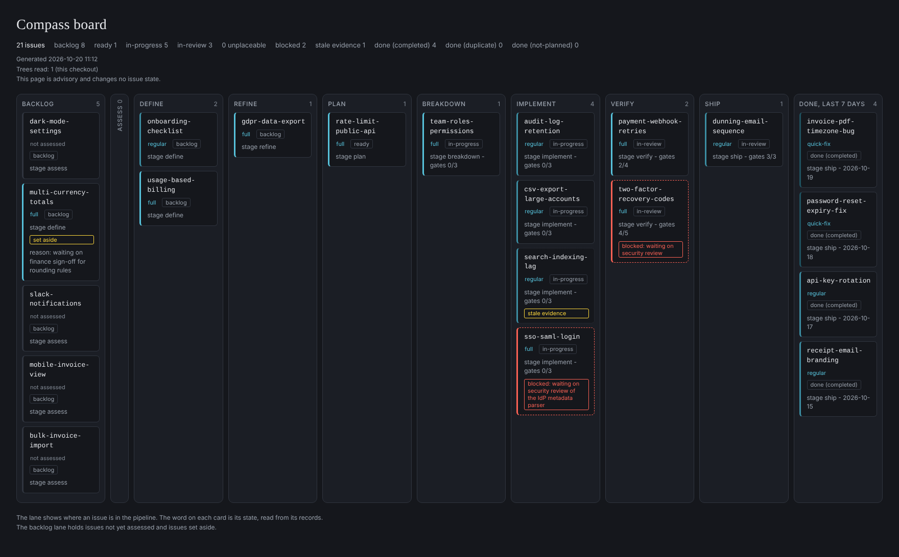

<h1>
  <picture>
    <source media="(prefers-color-scheme: dark)" srcset="assets/compass-header-dark.svg">
    
  </picture>
</h1>

**Adaptive spec-driven development for Claude Code.**

[](https://github.com/ayeo-io/compass/actions/workflows/compass.yml)
[](https://docs.ayeo.io/compass/)
[](https://github.com/ayeo-io/compass/releases)
[](LICENSE)

> Enough process for the work at hand. No more.

A typo fix should not need an architecture pack. A payments rewrite should
not begin with an unstructured prompt.

Compass assesses each change by **risk, familiarity and size**, then a
deterministic policy composes the delivery approach: which stages run at what
depth, which documents are worth writing, which checks run, and where a person
decides. Five guardrails hold on every approach. No assessment removes one.

<p align="center">
  
</p>

Judgment goes into the assessment. Everything after it is computed: the same
assessment plus the same policy gives the same approach, every time.

## Install

From a shell, in one line:

```bash
claude plugin install compass --marketplace ayeo-io/compass
```

Or from inside Claude Code, in two commands:

```text
/plugin marketplace add ayeo-io/compass
/plugin install compass@compass
```

Or from source:

```bash
git clone https://github.com/ayeo-io/compass.git
cd compass
bash scripts/install.sh --global
```

Add `bin/` to your `PATH` to make `compass` invokable, or call it as
`python3 cli/compass`. Needs Python 3.10 or later. See
[docs/install-smoke-test.md](docs/install-smoke-test.md) for checks and
troubleshooting.

## The first issue

Describe the work:

```text
/compass:go "Add rate limiting to the public API"
```

`/compass:go` assesses the change, shows the plan in three lines and starts.
`/compass:assess` does the assessment alone. When the approach reaches a stage
that waits for a person, the session stops and shows a request. You answer
in the same session:

```text
/compass:approve
/compass:reject "the criteria miss the burst case"
```

`/compass:status` reports what is blocked, moving and done. `/compass:resume
<issue>` picks an issue up in a later session, from its record on disk.
To write the specs and plans an issue asks for, read
[docs/writing-specs-and-plans.md](docs/writing-specs-and-plans.md).

The shipped guardrails are active from the first command. Project settings,
and a project's own changes to the shipped defaults, live in one file,
`compass.yml` ([docs/configuration.md](docs/configuration.md)). Upgrading from
6.x? Read [docs/upgrade-7-0-0.md](docs/upgrade-7-0-0.md); from 5.x, read
[docs/upgrade-6-0-0.md](docs/upgrade-6-0-0.md) first. To mirror an issue's
labels on its GitHub issue, see [docs/github-labels.md](docs/github-labels.md).

Compass complements your normal CI. It does not replace tests, linting,
security scanning, builds or deployment checks.

## What Compass changes

Compass chooses the process for each change from its assessment of risk,
familiarity and size.

| Work | Typical Compass response |
|---|---|
| **Quick fix** | One clear criterion, a focused change and evidence that it works. |
| **Regular** | Behavioral specification in Gherkin, proportionate technical design and review. |
| **Full** | Intent document, architecture and delivery plan, with detailed design and test strategy only where useful. |
| **Hotfix** | Reproduce first, fix safely, then do the follow-up work skipped for speed. |
| **Spike** | Time-boxed exploration. Record the learning; ship nothing directly. |

These are reference shapes, not fixed levels. A one-file authentication change
can get more protection than a large throwaway prototype, because risk and
size are different things. Optional switches for goal and urgency pick the
spike and the hotfix.

## Rigor without ritual

Compass separates two things that process frameworks often confuse:

- **Guardrails** are few and checkable: tested before shipping, acceptance
  defined before implementation, every change traced to a criterion,
  evidence rather than assertion, and a person's approval for anything
  irreversible. `compass check` fails on a breach under enforced adoption,
  and the
  [safety contract](docs/safety-contract.md) lists what it cannot see.
- **Strategies** are strong defaults that improve the work without becoming
  bureaucracy: BDD, TDD, decision records, architecture models and other
  practices that apply when they add value.

An approach can lower the process weight. It never removes a guardrail.

## A person stays in control

- **Approvals happen in the session.** `/compass:approve` and
  `/compass:reject` are the only way an approval is recorded. An agent cannot
  raise the event that records one.
- **You set the bounds of a delegation.** A bare `/compass:delegate` lets the
  agents of this session approve for you on every issue, until
  `/compass:revoke` ends it. Flags narrow it: `--agent`, `--until`, `--on`, `--for`
  and `--max`. `--for g5`, which covers irreversible work, needs a code that
  you type back. Compass lists each delegation with no end time at each new
  session start. Every delegated approval is on record, and you can overrule
  one.
- **Autonomy is a setting, not a promise.** `autonomy: controlled | balanced
  | autonomous` in `compass.yml` says how often a session stops for a person.
  An autonomous project must first pass the readiness floor: an agent
  instructions file, a build, a test suite under two minutes and a clean
  lint, measured by `compass readiness`. Below the floor, assess refuses.
- **Decisions an agent takes for you are listed**, and the record waits for
  you to confirm or change them.

## Resumable and auditable

Every issue leaves a reviewable record. Its documents are in
`docs/compass/<created>-<issue>/`; its manifest, evidence and markers are in
`.compass/work/<issue>/`. Another session can resume from that record without
the chat history, and a reviewer can open the evidence behind each gate.

`compass board render` shows every issue on one page, with a lane for each
stage. This example is an invented invoicing product:



## One pipeline, five roles

```text
assess → define → refine → plan → breakdown → implement → verify → ship
```

The stages stay the same while their depth adapts. Engineer, product owner,
designer, product marketer and QA each enter the same issue through their own
command; a product owner starts upstream with `/compass:intent`. A role is a
perspective a session consults. The documents it writes bring the gates. See
the [roles guide](docs/roles-guide.md).

## Built to port

Compass runs on Claude Code today, but its core is split on purpose:

- **Methodology:** plain-language guidance, governance and templates.
- **Kit:** the runtime-neutral Python CLI, schemas and policy engine.
- **Adapter:** the commands, agents, skills and hooks for Claude Code.

The slash commands are the pipeline; the CLI is the mechanism underneath them
([docs/cli.md](docs/cli.md)). A future runtime adapter calls the same kit
rather than reimplementing the rules ([docs/portability.md](docs/portability.md)).

## What the repository contains

```
commands/     the stage interface, under the /compass: namespace
agents/       distinct contexts - router, spec-author, planner, builder,
              verifier, reviewer, product-owner, product-marketer, architect
skills/       loadable procedures - adaptive-routing, bdd-specification,
              tdd-discipline, worktree-multiagent, intent-interview and the rest
hooks/        pre-tool.sh, post-tool.sh, stop.sh - mechanical enforcement
cli/compass   the kit: routing, checks and the manifest
bin/compass   the shim that puts the kit on your PATH
governance/   guardrails, strategies, routing policy, frozen vocabulary
approaches/   the reference shapes, and the artifacts each one earns
architecture/ Compass's own invariants and decision records
.claude-plugin/  the plugin manifest and marketplace entry
```

The first four are the Claude Code adapter and are rebuilt for another
runtime. Everything below them is reused unchanged.

## What Compass runs, sends and fetches

Compass works on your machine and in your repository. It reaches the network
only in the cases below, and each one starts only when you ask for it. The
full account is in [docs/security.md](docs/security.md).

- **Fetches** a brief you name over HTTPS, with `compass intent ingest --from
  <url>`. It refuses any scheme but `https`, on redirects too.
- **Fetches** a git parent when the project's `extends:` names one. It runs
  `git` for the one pinned commit and reads its `compass.yml` as data.
  Only `compass policy lint`, `compass policy show`, `compass policy diff`,
  `compass policy update`, `compass preset test` and `compass approach
  evaluate --write` fetch, and only a commit that is not cached yet; never
  `compass check`. `compass policy update` always asks the remote which
  commit its ref names, unless `COMPASS_OFFLINE=1` is set.
  `--offline` or `COMPASS_OFFLINE=1` stops the others fetching;
  `COMPASS_PARENT_REMOTE_BASE` names a mirror in place of `https://github.com`
  ([docs/git-parents.md](docs/git-parents.md)).
- **Sends** your delivery record to a git repository you configure, with
  `compass record sync`, which `compass ship-commit` also runs. It happens
  only when `compass.yml` names a `record:` remote, and it redacts
  credentials.
- **Starts** host sessions (`claude -p`) with `compass run`, which sends their
  prompts through Claude Code as any session does. Those sessions may not push
  or merge.
- **Runs** commands on your machine: the test command you give `compass
  tdd-red`, `compass tdd-green` and `compass quick-fix finish`, your
  project's own guardrails declared with `check: command-passes`, the
  readiness commands in `compass.yml`, git in your repository, and the CLI
  itself from the plugin's hooks.
- **Reads** the current Claude Code session's own transcript when a quick fix
  finishes, keeping only token counts, model names and times.
- **Clones and installs** other frameworks only in the evaluation harness,
  `evals/harness.py`, which maintainers run by hand.

## Read next

- **[Five-minute walkthrough](docs/five-minutes.md):** install Compass and ship a small issue.
- **[Methodology](docs/methodology.md):** the design and reasoning behind adaptive delivery.
- **[Safety contract](docs/safety-contract.md):** what Compass guarantees and what it does not.
- **[Security](docs/security.md):** hooks, dependencies, what runs and what is sent.
- **[Contributing](CONTRIBUTING.md):** what judges a pull request, and where to start.

## License

Apache 2.0. See [LICENSE](LICENSE).
