<h1>
  <picture>
    <source media="(prefers-color-scheme: dark)" srcset="assets/compass-header-dark.svg">
    
  </picture>
</h1>

**Acceptance-test-driven development for Claude Code, with a record a reviewer can check.**

[](https://github.com/ayeo-io/compass/actions/workflows/compass.yml)
[](https://docs.ayeo.io/compass/)
[](https://github.com/ayeo-io/compass/releases)
[](LICENSE)

Compass lets a team under change control hand code changes to an AI agent
and still show a reviewer, or an auditor, that the process was followed. A
person approves each change, and Compass records that approval. A reviewer
of one change asks five questions. Compass keeps the answer to each on
record:

- **Who asked?** The link to the request, and who made it.
- **What was agreed?** The scenarios, in the change's acceptance criteria.
  For a change labeled `auth`, `payments`, `personal-data` or `migrations`,
  or with critical risk, a person approves them before any code edit.
- **Do the tests fail without the change, and pass with it?** Compass runs
  them on a copy of the commit the change started from, where they must
  fail, and on the working tree, where they must pass. This does not show
  that a test was written before the code
  ([docs/base-copy.md](docs/base-copy.md)).
- **Who approved?** One person approves each change. The person types
  `/compass:approve` when Compass asks, or Compass reads the approval from
  the merged pull request: an approving review by someone other than its
  author. An approval covers the change the person saw. After a later
  change, Compass asks again.
- **What shipped?** The commit and the pull request.

Each change leaves one plain file, `trail.md`, with a SHA-256 digest for each
record it names. A reviewer checks it with `sha256sum -c`, without Compass
installed.

**Who it is for.** Teams that work under change control and want an agent's
speed without losing the trail: a reviewer asks for the evidence of one
change, an auditor asks for the evidence of every change. ISO 27001 and
SOC 2 both expect each change to be authorized and traceable. Compass keeps
the records such a process reads. This is not checked against a specific
audit.

## What one change leaves

Compass writes `trail.md` into the change's record when it commits the
change, and `compass trail` writes it again on demand. It answers the
five questions in six sections, with red and green apart:

1. Who asked
2. What was agreed
3. Red, for each scenario
4. Green
5. Who approved, and by what authority
6. What shipped

Under each statement are lines in `sha256sum` format: a digest and the path
of the file that holds the evidence. The code and test files are named
with the digests the last passing run recorded, so the check shows that the
committed code is the code that was tested. From the repository root:

```bash
grep -E '^[0-9a-f]{64}  ' .compass/work/<issue>/trail.md | sha256sum -c -
```

The requester is a claim the session records; Compass does not check it
([docs/delivery-record.md](docs/delivery-record.md)).

## Install

From a shell, in one line:

```bash
claude plugin install compass --marketplace ayeo-io/compass
```

Or from inside Claude Code, in two commands:

```text
/plugin marketplace add ayeo-io/compass
/plugin install compass@compass
```

Or from source:

```bash
git clone https://github.com/ayeo-io/compass.git
cd compass
bash scripts/install.sh --global
```

Add `bin/` to your `PATH` to make `compass` invokable, or call it as
`python3 cli/compass`. Needs Python 3.10 or later. See
[docs/install-smoke-test.md](docs/install-smoke-test.md) for checks and
troubleshooting.

## The first change

Describe the work:

```text
/compass:go "Add rate limiting to the public API"
```

The session runs two `compass` commands
([docs/five-minutes.md](docs/five-minutes.md)):

1. `compass quick-fix start` opens the issue. It records the request, who
   asked, the first scenario and the evidence the change owes.
2. The session writes the scenarios
   ([docs/writing-specs-and-plans.md](docs/writing-specs-and-plans.md)), the
   tests and the code, and runs the tests directly.
3. `compass quick-fix finish` writes the record. It reads the scenarios and
   the changed files, shows that the tests fail without the change and pass
   with it, runs `compass check` and asks for your approval.
4. After you approve, the same `finish` commits the change and its record,
   with `trail.md`, on a branch.

Each command prints a `next:` line with the one step that comes next. When
the change waits for a person, the session stops and shows a request. You
answer in the same session:

```text
/compass:approve
/compass:reject "the criteria miss the burst case"
```

`/compass:status` reports what is blocked, moving and done. `/compass:resume
<issue>` picks an issue up in a later session, from its record on disk. To
link an issue to its GitHub issue and pull request, see
[docs/github-links.md](docs/github-links.md).

The shipped guardrails are active from the first command. Project settings
live in one file, `compass.yml` ([docs/configuration.md](docs/configuration.md)).
A setting there can only add to the check set; to excuse one check on one
issue, see [docs/waivers.md](docs/waivers.md).

Upgrading from 8.x? Read [docs/upgrade-9-0-0.md](docs/upgrade-9-0-0.md) and
run `compass migrate`. Compass 8.x gets security fixes only, for 90 days
after 9.0.0 is released. A project on 6.x or 7.x upgrades to 8.x first
([docs/upgrade-7-0-0.md](docs/upgrade-7-0-0.md), and from 5.x
[docs/upgrade-6-0-0.md](docs/upgrade-6-0-0.md)).

Compass complements your normal CI. It does not replace tests, linting,
security scanning, builds or deployment checks.

## What Compass changes

Compass chooses the evidence each change owes from its assessment and the
project's settings. Every change that ships owes the same evidence: a link to the request and
who asked, scenarios, tests that fail without the change and pass with it, a
green suite, three gates that Compass passes from those records, and one
person's approval ([safety contract](docs/safety-contract.md)). Risk, size,
familiarity and urgency add no review and no record. Three things add to it:

| Work | What Compass adds |
|---|---|
| **`auth`, `payments`, `personal-data` or `migrations`, or a label the project adds** | A person approves the scenarios before any code edit, and signs off before the change lands. |
| **Critical risk** | A person approves the scenarios before any code edit. |
| **A project's `require_evidence` setting** | The evidence it names, such as the security review or the Definition of Done ([docs/configuration.md](docs/configuration.md)). |
| **Spike** | Time-boxed exploration, off the path. Record the learning; ship nothing directly. |

<p align="center">
  
</p>

Five guardrails apply to all work that ships code, whatever the assessment:
a test that fails without the change, acceptance criteria before code, code
traced to a criterion, typed evidence rather than a written claim, and a
person's approval for a change labeled `auth`, `payments`, `personal-data` or
`migrations`. `compass check` fails on a breach under enforced adoption.
Every project runs one fixed check set: a project can add checks of its own,
report failures without blocking while it tries Compass, or excuse one check
on one issue with a waiver a person approves. The
[safety contract](docs/safety-contract.md) lists what Compass cannot see.

Judgment goes into the assessment. Everything after it is computed from the
assessment and the settings of `compass.yml`, so the same two inputs give the
same evidence, every time
([safety contract](docs/safety-contract.md#1-routing-is-deterministic-after-assessment)).

## A person stays in control

- **Approvals are a person's act.** In Claude Code you type
  `/compass:approve` or `/compass:reject`; at a terminal you run `compass
  evidence approve`. An agent cannot type the command that records an
  approval, because Claude Code does not let the model run `/compass:approve`.
  An agent records one only under a delegation you made, and a program
  running as your own user account is not stopped
  ([safety contract](docs/safety-contract.md#5-irreversible-work-needs-recorded-human-approval)).
- **A person approves each change.** `compass quick-fix finish` writes the
  request, and commits after you type `/compass:approve`. The approval names
  a digest of the change. When the code or the tests change afterwards,
  `finish` asks again, and `compass check` fails until you approve the new
  state. Compass also reads the approval from the merged pull request: a
  review that approves it, by a person who is not its author, read by
  `compass issue link set --pr <n>` after the merge. The pre-tool hook
  refuses an agent's `gh pr review --approve`
  ([docs/github-links.md](docs/github-links.md)).
- **You set the bounds of a delegation.** A bare `/compass:delegate` lets the
  agents of this session approve for you on every issue, until
  `/compass:revoke` ends it. Flags set its bounds: `--agent` names one agent,
  in any session; `--until`, `--on`, `--for` and `--max` narrow it. `--for
  g5`, which covers irreversible work, `--for waivers` and `--for ship`,
  which covers the ship approval of a change, each need a code that you
  type back. Compass lists each delegation with no end time at each new
  session start. Every delegated approval is on record, with a copy of the
  delegation in the issue's manifest, and you can overrule one; overruling a
  guardrail 5 sign-off does not undo work already landed.
- **Autonomy is a setting, not a promise.** `autonomy: controlled | balanced
  | autonomous` in `compass.yml` says how often a session stops for a person.
  It changes no gate, check or hook.

## The record

Each issue's documents are in `docs/compass/<created>-<issue>/`; its
manifest, evidence and markers are in `.compass/work/<issue>/`. Another
session can resume from that record without the chat history. By default the
record ships in the same commit as the code: `compass quick-fix finish` and
`compass ship-commit` stage it, and leave out the per-checkout files such as generations and lock files. A
project that sets `record.commit: false`, or names a `record:` remote and
does not set `record.commit`, keeps the record out of its commits
([docs/delivery-record.md](docs/delivery-record.md)). `compass flow` lists
every issue by state, with what is blocked and whose evidence is stale.

## What Compass runs, sends and fetches

Compass works on your machine and in your repository. It reaches the network
only in the cases below, and each one starts only when you ask for it. The
full account is in [docs/security.md](docs/security.md).

- **Fetches nothing for a configuration.** Compass runs one fixed check set
  (ADR-094). An `extends:` that names a git parent is refused with
  `L-PARENT-REMOVED`, and no command runs `git` to fetch one: not `compass
  policy lint`, `compass policy show`, `compass approach evaluate --write` or
  `compass check`.
- **Sends** your delivery record to a git repository you configure, with
  `compass record sync`, which `compass ship-commit` also runs. It happens
  only when `compass.yml` names a `record:` remote, and it redacts
  credentials.
- **Runs** commands on your machine: the test command you give `compass
  tdd-red`, `compass tdd-green` and `compass quick-fix finish`, which also
  runs it in a temporary copy of the commit the change started from, and, when
  `allow_project_commands` is true, your project's own checks declared
  under `project_checks` in `compass.yml`;
  also git in your repository, and the CLI itself from the plugin's hooks.
- **Reads** a pull request with `gh` when you run `compass issue link set
  --pr`: its number, state, author, head and merge commit, and after the
  merge its reviews and the login `gh` reads as. Compass writes nothing to
  GitHub ([docs/security.md](docs/security.md)).

## What the repository contains

```
commands/     the slash commands, under the /compass: namespace
skills/       loadable procedures - atdd, tdd-discipline, adaptive-routing
              and the rest
hooks/        pre-tool.sh, post-tool.sh, stop.sh, session-start.sh,
              prompt-approval.sh, approval-summary.sh - mechanical enforcement
cli/compass   the CLI: assessment, checks, the manifest and the trail
bin/compass   the shim that puts the CLI on your PATH
governance/   guardrails, strategies, the check set, frozen vocabulary
approaches/   the path, the spike, and how assess selects the evidence
architecture/ Compass's own invariants and decision records
.claude-plugin/  the plugin manifest and marketplace entry
```

The commands, skills and hooks are the Claude Code adapter; the CLI under
them does not depend on Claude Code ([docs/cli.md](docs/cli.md),
[docs/portability.md](docs/portability.md)).

## Read next

- **[Five-minute walkthrough](docs/five-minutes.md):** install Compass and ship a small issue.
- **[Safety contract](docs/safety-contract.md):** what Compass guarantees and what it does not.
- **[Delivery record](docs/delivery-record.md):** what an issue records, and how to check `trail.md`.
- **[Methodology](docs/methodology.md):** the design and reasoning behind Compass.
- **[Security](docs/security.md):** hooks, dependencies, what runs and what is sent.
- **[Contributing](CONTRIBUTING.md):** what judges a pull request, and where to start.

## License

Apache 2.0. See [LICENSE](LICENSE).
