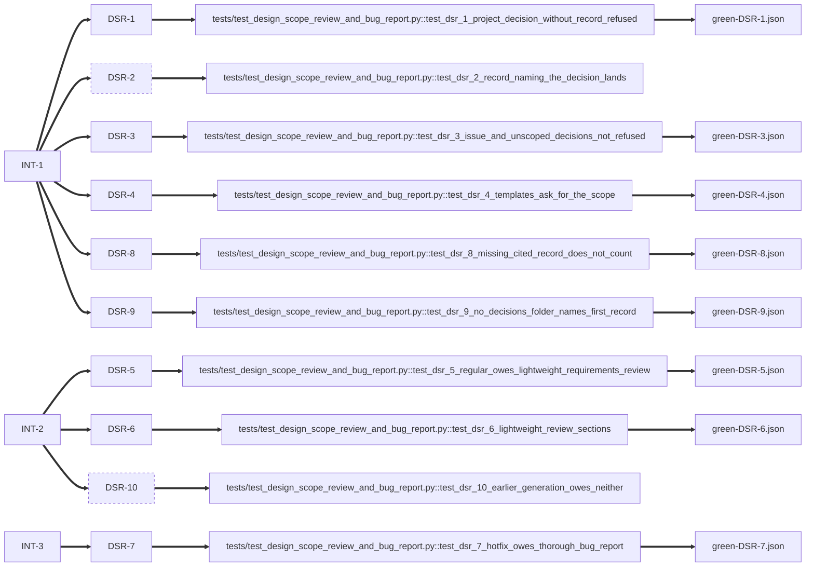

# design-scope-review-and-bug-report

<!-- compass:render header -->
**`design-scope-review-and-bug-report`** - regular - in-review - stage implement - gates 3/7
Owner: jed72 - Created: 2026-10-18
To see this issue across the board, run `compass board render`.
<!-- /compass:render -->

<!-- compass:render ask -->
**Problem**

A design decision that applies to the whole project can ship with no decision record. The technical design holds it, the issue closes, and the next issue that meets the same question cannot find it in `architecture/decisions/`.

Two approaches also lack a record they need. The regular approach runs a lightweight refine stage, but owes no requirements review, so the review leaves no file. The hotfix approach owes no bug report, so the reproduction its define stage writes has nothing to be checked against.

**Desired outcome**

- INT-1: A design decision states whether it applies to the issue or to the project, and a project-wide decision cannot land without a decision record that names it.
- INT-2: A regular issue leaves a short requirements review: the self-QA, the ambiguity ledger and the Definition of Ready.
- INT-3: A hotfix leaves a bug report that its reproduction is checked against.

**Success signals**

- `compass ship-commit` refuses an issue whose design holds a project-scoped decision with no decision record, and names the record to write.
- A new regular issue owes `requirements-review` at lightweight depth, and `compass issue template show requirements-review --depth lightweight` prints three sections.
- A new hotfix owes `bug-report` at thorough depth.

**Non-goals**

- Deciding for the author which decisions are project-scoped. The architect proposes that in `architecture-notes.md`; a person decides.
- Changing an issue already assessed: it keeps its stored generation.
- Changing the stage modes of either approach.
<!-- /compass:render -->

<!-- compass:render decision-required -->
No decision required. Nothing is awaiting approval.
<!-- /compass:render -->

<!-- compass:render acceptance -->
Acceptance: 8 of 10 scenarios passed

- `DSR-1` - A project-scoped decision with no record is refused at landing - passed
- `DSR-2` - A decision record that names the decision lets the issue land - not yet passed
- `DSR-3` - Issue-scoped and unscoped decisions are not refused - passed
- `DSR-4` - The templates ask for the scope - passed
- `DSR-5` - A new regular issue owes a lightweight requirements review - passed
- `DSR-6` - The lightweight review has three sections - passed
- `DSR-7` - A new hotfix owes a thorough bug report - passed
- `DSR-8` - A cited record that does not exist does not count - passed
- `DSR-9` - A project with no decisions folder is told the first record to write - passed
- `DSR-10` - An issue assessed before the change owes neither document - not yet passed
<!-- /compass:render -->

<!-- compass:render related -->
None
<!-- /compass:render -->

<!-- compass:render decisions -->
- `DD-1` - A landing refusal reads the decision scope from the registered design - scope: project - [ADR-071](../../../architecture/decisions/ADR-071-a-project-scoped-design-decision-needs-a-record-and-regular-and-hotfix-owe-a-review-and-a-bug-report.md)
- `DD-2` - A record names a decision by citation or by slug and id - scope: project - [ADR-071](../../../architecture/decisions/ADR-071-a-project-scoped-design-decision-needs-a-record-and-regular-and-hotfix-owe-a-review-and-a-bug-report.md)
- `DD-3` - The two documents are preset values, and no new field gates them - scope: project - [ADR-071](../../../architecture/decisions/ADR-071-a-project-scoped-design-decision-needs-a-record-and-regular-and-hotfix-owe-a-review-and-a-bug-report.md), [ADR-036](../../../architecture/decisions/ADR-036-an-issue-runs-against-a-stored-generation.md), [ADR-037](../../../architecture/decisions/ADR-037-configuration-changes-are-classified-by-effect.md)
- `DD-4` - A decision with no scope line is not refused - scope: issue
- `Q1` (open) The requirement asks for an `architecture/decisions/ADR-*` file "naming" the decision. Decisions are numbered per issue, so `DD-2` alone is not unique across the project. - A project-scoped decision is recorded when its block in the design cites an ADR id whose file exists in `architecture/decisions/`, or when a file there names both the issue's slug and the decision id. A citation of a missing file does not count (DSR-8).
- `Q2` (open) The requirement says every decision carries a scope. Should a decision with no scope line be refused? - No. Only a declared `project` scope is refused. Every design written before 7.0.0 has no scope line, and refusing those would block their landings. The template asks for the line, so new designs carry it.
- `Q3` (open) The release-line refusal fires only when the issue's stored generation sets `release_line: true`. Does this refusal need a field like that? - No. It fires only on a decision that declares `Scope: project`, and no design in the archive declares one (checked with a search of `docs/compass/*/technical-design.md` on 18 October 2026). An author who writes the line asks for the check.
- `Q4` (open) The requirement says the reproduction is the define stage's record. The catalogue lists `bug-report` at stage `assess`. - The catalogue keeps `assess`. The report states the defect at intake, and the hotfix's reproduce-first define stage writes the failing test against it. Moving the stage would change when every project's bug report is due.
<!-- /compass:render -->

<!-- compass:render artifacts -->
Documents: 6 registered, 4 approved

| Document | Status | Approved by | Why it exists |
|---|---|---|---|
| [intent](intent.md) | approved | compass issue artifact set | every regular approach carries a lightweight one |
| [acceptance-criteria](acceptance-criteria.md) | approved | compass tdd-red | changed after it was approved by compass issue artifact set (digest 80f768efe96b then d9ba7876864a) |
| [technical-design](technical-design.md) | approved | compass tdd-red | every regular approach carries one |
| distribution-map | not needed: no subtasks recorded | - | every regular approach carries a lightweight one |
| verification-report | not written yet | - | every regular approach carries one |
| [delivery-approach](delivery-approach.md) | approved | compass issue artifact set | registered by hand; no rule of the assessment asked for it |
<!-- /compass:render -->

<!-- compass:render traceability -->

Not tied to a scenario: `green.json`
<!-- /compass:render -->

<!-- compass:render deliberately-omitted -->
Nothing recorded as omitted.
<!-- /compass:render -->

<!-- compass:render follow-ups -->
No follow-ups recorded.
<!-- /compass:render -->
