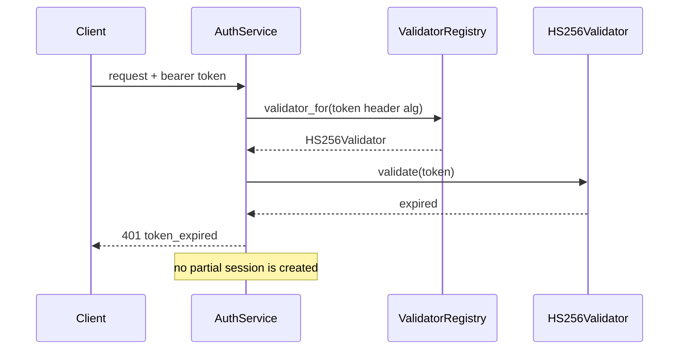
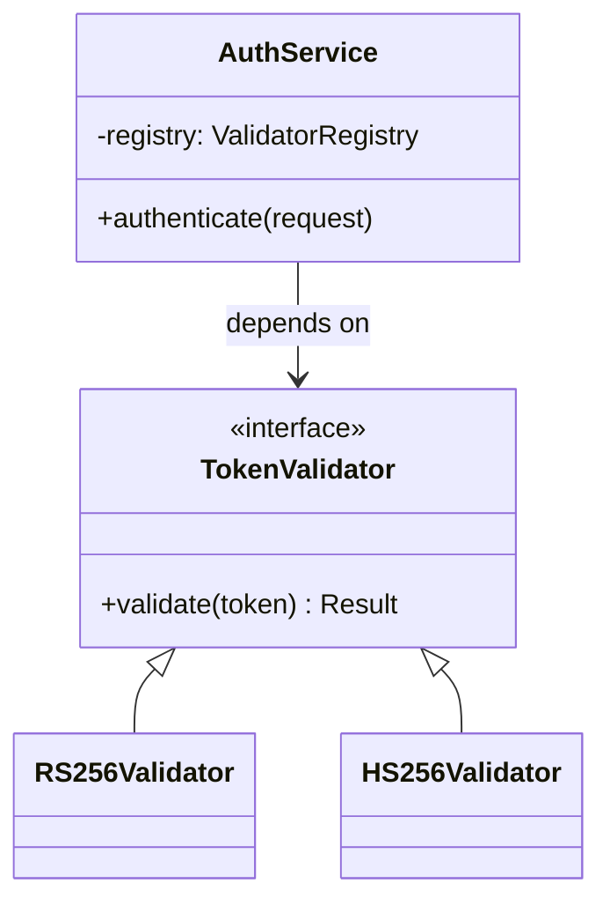

# Writing specs and plans

This page shows the cold-reader strategy (`S7`, `governance/strategies.md`)
applied to a spec and a plan, with a weak and a better version of each
passage. A cold reader was not in the conversation and cannot ask you a
question. The test of a passage is whether that reader can act on it.

Compass needs and checks one document, `acceptance-criteria.md` (ADR-091). A
plan is a design note a team keeps beside it. Compass does not read the
plan.

## Example 1 - a spec Summary

Every `acceptance-criteria.md` opens with a Summary: **Goal**, **Approach**,
and **Why now / what changes**. A reviewer reads it first.

**Weak**

> **Goal:** Improve the export.
>
> **Approach:** Refactor the export module and add the new fields.
>
> **Why now / what changes:** Users have asked for this.

**Better**

> **Goal:** Let finance produce a month-end ledger they can file without
> hand-editing it first.
>
> **Approach:** The export gains three columns finance currently adds by hand
> (cost centre, VAT code, reconciliation ref) and excludes draft entries, which
> are the main reason exports get re-run. The generation path is unchanged.
>
> **Why now / what changes:** Finance re-runs this export two or three times
> each month-end because drafts slip in. After this change the first export is
> the one they file, and the three columns they paste in by hand arrive
> populated.

**What changed:** the weak version fits a hundred changes. The better one
fits only this change.

## Example 2 - a design decision

A design decision goes in the plan, or in an ADR when it binds later
issues. A decision that names no real alternative is a preference.

**Weak**

> ### DD-1 - Use a queue
>
> - **Context:** We need to handle the load.
> - **Decision:** Use a queue.
> - **Alternatives considered:** Doing it synchronously.
> - **Consequences:** Better performance.

**Better**

> ### DD-1 - Exports are generated on a queue, not in the request
>
> - **Context:** A month-end export for the largest account takes 40 to 90
>   seconds to build. The gateway times out at 30, so today it fails for
>   precisely the accounts that need it most.
> - **Decision:** The request enqueues a job and returns a job id immediately;
>   the client polls for the finished file.
> - **Alternatives considered:** Streaming the response, which keeps one request
>   but leaves a partial file on disconnect and does not fix the underlying
>   40-to-90-second build. Raising the gateway timeout, which moves the ceiling
>   without removing it and slows every other endpoint behind the same proxy.
> - **Consequences:** Commits us to a job store and a polling endpoint. Clients
>   must handle a two-step flow, so the API is no longer a single call.
> - **Governance tie:** the tested-before-ship guardrail (`G1`) - the job path needs its own test surface.

**What changed:** the better version gives a later reader enough to reopen
the choice when the constraints change.

## Example 3 - a scenario name

A reader reads many more scenario names than scenario bodies.

**Weak**

> `Scenario: test export`
>
> `Scenario: check the token logic`
>
> `Scenario: it should work correctly`

**Better**

> `Scenario: a draft entry should be excluded from the month-end export`
>
> `Scenario: an expired reset token should be rejected`
>
> `Scenario: an export for an account with no entries should return an empty file, not an error`

**What changed:** each name states an outcome, not a call path. A reader can
scan the spec and open no scenario body.

## Example 4 - a plan work unit

The build stage runs the plan's work units, one after another. A vague
unit is found only after the work starts.

**Weak**

> | Unit | Scenario group(s) | Code surface | Independent of |
> |---|---|---|---|
> | U1 | group A | the export code | U2 |
> | U2 | similar to U1 | TBD | U1 |
>
> Write tests for the above.

**Better**

> | Unit | Scenario group(s) | Code surface | Independent of |
> |---|---|---|---|
> | U1 | group A - TRC-A1, TRC-A2 | `src/export/ledger.py`, `src/export/columns.py` | U2 - disjoint files and disjoint scenarios |
> | U2 | group B - TRC-B1 | `src/jobs/queue.py`, `src/api/jobs.py` | U1 - as above |
>
> Tests: `tests/test_ledger_export.py::test_excludes_drafts`,
> `tests/test_jobs.py::test_returns_job_id`.

**What changed:** each cell a builder would ask about is filled in, and the
independence claim gives its reason.

Do not leave a placeholder (`TBD`, `TODO`, "implement later", "add
appropriate error handling"), or a work unit that promises tests and names
none.

## A worked plan - every optional section rendered

<!-- Not "## Example 5": the numbered examples are weak-and-better pairs. -->

A plan can use five optional sections: a **Summary**, an **interaction**
diagram, a **structure** diagram, **named design patterns** and **the shape
of the change** in code. They let a reviewer see a design before it is
built. `skills/governance-check/SKILL.md`, "Writing the design down", has
the rule for each.

- A small change writes no design.
- A larger change uses the one or two sections that add clarity.
- A change that owes `architecture` can use all five.
- Delete the headings you do not use.

The example below adds a second JWT signing algorithm.

### 0. Summary

**Goal:** Accept tokens signed with HMAC as well as RSA, so partners who
cannot manage a key pair can still integrate.

**Approach:** Introduce a `TokenValidator` interface with one implementation
per algorithm, selected by the token header. `AuthService` depends on the
interface and stops knowing about algorithms at all.

**Why now / what changes:** Two partners are blocked on RSA key management.
Afterwards an integrator can sign with a shared secret, and adding a third
algorithm is a new class rather than a new branch in `AuthService`.

### 2. Interaction - sequence diagram



The diagram shows the failure path: the 401 returns before any session row
is written.

### 3. Structure - what talks to what



Algorithm selection happens in one place. How a validator is configured
stays in the existing config loader.

### 4. Design patterns invoked

> - **Strategy** (GoF) - `TokenValidator` lets `AuthService` swap signature
>   algorithms without knowing which is in play. Justified because we
>   already ship RS256, are adding HS256 now, and EdDSA is on the roadmap:
>   three variants is where a conditional stops being cheaper than a type.
> - **Registry** - `ValidatorRegistry` maps an algorithm name to its
>   validator. Justified because the mapping is data the config already
>   owns, and putting it in a registry keeps `AuthService` free of a lookup
>   table that would need a test per entry.

Name a pattern only with its reason. A reviewer cannot disagree with a bare
name.

### 5. The shape of the change

```python
class TokenValidator(Protocol):
    def validate(self, token: str) -> Result: ...

class ValidatorRegistry:
    def validator_for(self, alg: str) -> TokenValidator: ...

class AuthService:
    def __init__(self, registry: ValidatorRegistry): ...
    def authenticate(self, request) -> Claims: ...
```

The code shows an interface, not an implementation. It lets a reviewer
question the `Result` return type before four call sites exist.

**PlantUML.** Both diagrams are Mermaid, which GitHub renders. Use PlantUML
only as the fallback for a shape Mermaid cannot express: some readers will
see its source and no picture.

## What Compass deliberately does not adopt

| Not adopted | Why |
|---|---|
| A subagent review loop between the spec and the plan | The R1 project shipped such a loop and removed it in its [v5.0.6 release](R1/releases/tag/v5.0.6): tests across five versions and five trials found the same quality scores with and without it, at about 25 minutes of overhead for each run. Compass has not repeated that measurement. Compass keeps two reviews: the self-review at specify (the four scans in the `atdd` skill) and the review at ship, which passes the gates with evidence. |
| The user-story format as the spec | ADR-004 rejects it. A user story holds one role's view, so each role wants its own version and the versions drift. Compass has one `acceptance-criteria.md` for every reader. User stories are fine in a brief or a ticket. |
| A single-audience declaration, such as "assume the reader is a junior engineer" | The five roles read the same spec for intent, claims, tests, coverage and UI behavior. `S7` already assumes a reader with no context. |
| A plan made of small steps, each with the exact commands to run | The work between `compass quick-fix start` and `compass quick-fix finish` is tests and code, and `finish` proves the red and the green. A copy in the plan goes out of date when the code changes. The `governance-check` skill keeps the useful part as the author's self-review: a plan holds no unfinished promise. |

## Related

- `governance/strategies.md` - the cold-reader strategy (`S7`) and the
  persistence-over-conversation strategy (`S4`).
- `skills/atdd/SKILL.md` - the Summary section, the four-scan self-review,
  and what makes a scenario runnable.
- `skills/governance-check/SKILL.md` - the strategies walk, where a reviewer
  judges an unfinished plan.
- `architecture/decisions/ADR-004-one-spec-many-lenses.md` - why the spec is one <!-- vocabulary-scan: allow - the record's own filename; ADR-004 keeps the word its decision was about, so a citation must name the real file -->
  artifact, not one for each role.
