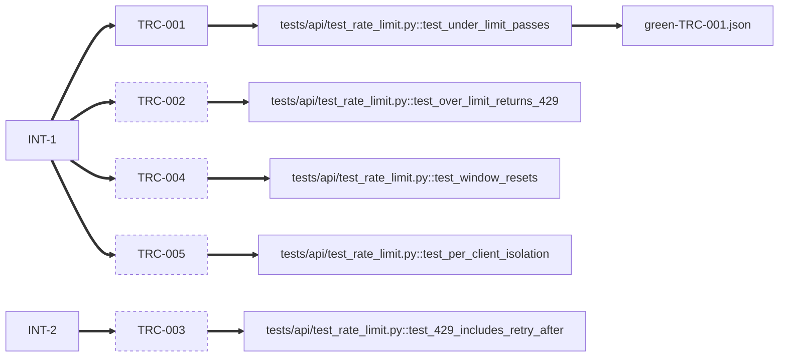

# rate-limit-search-endpoint

<!-- compass:render header -->
**`rate-limit-search-endpoint`** - regular - done (completed) - stage done - gates 6/6
Owner: not recorded - Created: 2026-04-21 - Completed: 2026-08-04
To see this issue across the board, run `compass board render`.
<!-- /compass:render -->

<!-- compass:render ask -->
**Issue**

Add per-client rate limiting to the public `/search` endpoint - it has no limit today and one client's bulk job degraded latency for everyone last week.

**Scenarios**

- `TRC-001` - Requests under the limit pass through unchanged
- `TRC-002` - The request over the limit is rejected with 429
- `TRC-003` - A 429 response tells the client when to retry
- `TRC-004` - The window resets and the client can call again
- `TRC-005` - Two clients have independent limits
<!-- /compass:render -->

<!-- compass:render decision-required -->
No decision required. Nothing is awaiting approval.
<!-- /compass:render -->

<!-- compass:render acceptance -->
Acceptance: 1 of 5 scenarios passed

- `TRC-001` - Requests under the limit pass through unchanged - passed
- `TRC-002` - The request over the limit is rejected with 429 - not yet passed
- `TRC-003` - A 429 response tells the client when to retry - not yet passed
- `TRC-004` - The window resets and the client can call again - not yet passed
- `TRC-005` - Two clients have independent limits - not yet passed
<!-- /compass:render -->

<!-- compass:render related -->
None
<!-- /compass:render -->

<!-- compass:render decisions -->
- `DD-1` - Counter storage backend
- `DD-2` - Fixed window, fail-closed on unknown client
<!-- /compass:render -->

<!-- compass:render artifacts -->
Documents: 5 registered, 0 approved

| Document | Status | Approved by | Why it exists |
|---|---|---|---|
| [acceptance-criteria](acceptance-criteria.md) | draft | - | found on disk when the documents were relocated |
| [delivery-approach](delivery-approach.md) | draft | - | found on disk when the documents were relocated |
| [requirements-review](requirements-review.md) | draft | - | found on disk when the documents were relocated |
| [technical-design](technical-design.md) | draft | - | found on disk when the documents were relocated |
| [verification-report](verification-report.md) | draft | - | found on disk when the documents were relocated |
<!-- /compass:render -->

<!-- compass:render traceability -->

<!-- /compass:render -->

<!-- compass:render deliberately-omitted -->
Nothing recorded as omitted.
<!-- /compass:render -->

<!-- compass:render follow-ups -->
No follow-ups recorded.
<!-- /compass:render -->
