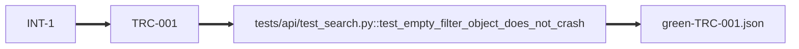

# search-crash-on-empty-filter

<!-- compass:render header -->
**`search-crash-on-empty-filter`** - hotfix - done (completed) - stage done - gates 5/5
Owner: not recorded - Created: 2026-05-11 - Completed: 2026-08-04
To see this issue across the board, run `compass board render`.
<!-- /compass:render -->

<!-- compass:render ask -->
**Issue**

`/search` returns a 500 for any request whose `filter` is an empty object `{}` - a mobile-client release started sending that shape this morning and is crashing for every user on the new build.

**Scenarios**

- `TRC-001` - Search with an empty filter object returns results, does not crash
<!-- /compass:render -->

<!-- compass:render decision-required -->
No decision required. Nothing is awaiting approval.
<!-- /compass:render -->

<!-- compass:render acceptance -->
Acceptance: 1 of 1 scenarios passed

- `TRC-001` - Search with an empty filter object returns results, does not crash - passed
<!-- /compass:render -->

<!-- compass:render related -->
None
<!-- /compass:render -->

<!-- compass:render decisions -->
None
<!-- /compass:render -->

<!-- compass:render artifacts -->
Documents: 3 registered, 0 approved

| Document | Status | Approved by | Why it exists |
|---|---|---|---|
| [acceptance-criteria](acceptance-criteria.md) | draft | - | found on disk when the documents were relocated |
| [delivery-approach](delivery-approach.md) | draft | - | found on disk when the documents were relocated |
| [verification-report](verification-report.md) | draft | - | found on disk when the documents were relocated |
<!-- /compass:render -->

<!-- compass:render traceability -->

<!-- /compass:render -->

<!-- compass:render deliberately-omitted -->
Nothing recorded as omitted.
<!-- /compass:render -->

<!-- compass:render follow-ups -->
- `FU-001` (resolved) 
- `FU-002` (resolved) 
- `FU-003` (resolved) 
<!-- /compass:render -->
