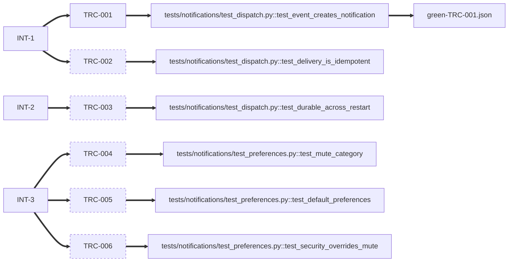

# notifications-subsystem

<!-- compass:render header -->
**`notifications-subsystem`** - full - done (completed) - stage done - gates 7/7
Owner: not recorded - Created: 2026-03-02 - Completed: 2026-08-04
To see this issue across the board, run `compass board render`.
<!-- /compass:render -->

<!-- compass:render ask -->
**Problem**

Users have no way to know something happened in the product unless they are
looking at the exact screen where it happened. A teammate comments on their
document, a long export finishes, their access to a workspace changes - all of
it is invisible unless they happen to be there. Support sees the cost daily:
"I didn't know my export was ready", "nobody told me I was removed". There is
no notifications capability at all today - this is a missing subsystem, not a
weak one.

**Desired outcome**

A user is reliably told about the events that affect them - in-app to start -
and can tune what they hear about, without being able to mute the things they
must not miss.

**Success signals**

- A user sees a notification for a relevant event within seconds of it
  happening, without being on the originating screen.
- A user who mutes a category stops seeing it - and the mute survives sessions.
- Security-relevant notifications reach the user even if they have muted
  everything else.
- Support tickets of the form "nobody told me…" drop noticeably the cycle after
  launch.

**Non-goals**

- We are NOT building email/push/SMS channels in this issue.
- We are NOT building a notification *digest* or batching/quiet-hours logic.
- We are NOT building an admin console for notification templates.
<!-- /compass:render -->

<!-- compass:render decision-required -->
No decision required. Nothing is awaiting approval.
<!-- /compass:render -->

<!-- compass:render acceptance -->
Acceptance: 1 of 6 scenarios passed

- `TRC-001` - An in-app event produces a notification for the target user - passed
- `TRC-002` - A notification is delivered once, even if the event is retried - not yet passed
- `TRC-003` - Notifications survive a worker restart - not yet passed
- `TRC-004` - A user mutes a category and stops receiving that category - not yet passed
- `TRC-005` - A user with no saved preferences gets the safe defaults - not yet passed
- `TRC-006` - A muted category does not suppress a security notification - not yet passed
<!-- /compass:render -->

<!-- compass:render related -->
None
<!-- /compass:render -->

<!-- compass:render decisions -->
- `DD-1` - Security override is a fixed category, not a per-notification flag
- `DD-2` - Idempotency key on the notification row, once-ever dedup
- `DD-3` - Durability via write-before-deliver, not an in-memory queue
<!-- /compass:render -->

<!-- compass:render artifacts -->
Documents: 7 registered, 0 approved

| Document | Status | Approved by | Why it exists |
|---|---|---|---|
| [acceptance-criteria](acceptance-criteria.md) | draft | - | found on disk when the documents were relocated |
| [delivery-approach](delivery-approach.md) | draft | - | found on disk when the documents were relocated |
| [distribution-map](distribution-map.md) | draft | - | found on disk when the documents were relocated |
| [intent](intent.md) | draft | - | found on disk when the documents were relocated |
| [requirements-review](requirements-review.md) | draft | - | found on disk when the documents were relocated |
| [technical-design](technical-design.md) | draft | - | found on disk when the documents were relocated |
| [verification-report](verification-report.md) | draft | - | found on disk when the documents were relocated |
<!-- /compass:render -->

<!-- compass:render traceability -->

<!-- /compass:render -->

<!-- compass:render deliberately-omitted -->
Nothing recorded as omitted.
<!-- /compass:render -->

<!-- compass:render follow-ups -->
No follow-ups recorded.
<!-- /compass:render -->
