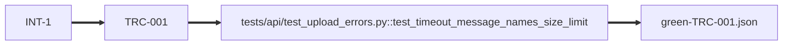

# fix-timeout-error-message

<!-- compass:render header -->
**`fix-timeout-error-message`** - quick-fix - done (completed) - stage done - gates 3/3
Owner: not recorded - Created: 2026-05-04 - Completed: 2026-08-04
To see this issue across the board, run `compass board render`.
<!-- /compass:render -->

<!-- compass:render ask -->
**Issue**

The upload timeout error tells users to "try again later" - it should name the file-size limit, which is the actual cause.

**Scenarios**

- `TRC-001` - Upload timeout reports the real cause and the real limit
<!-- /compass:render -->

<!-- compass:render decision-required -->
No decision required. Nothing is awaiting approval.
<!-- /compass:render -->

<!-- compass:render acceptance -->
Acceptance: 1 of 1 scenarios passed

- `TRC-001` - Upload timeout reports the real cause and the real limit - passed
<!-- /compass:render -->

<!-- compass:render related -->
None
<!-- /compass:render -->

<!-- compass:render decisions -->
None
<!-- /compass:render -->

<!-- compass:render artifacts -->
Documents: 3 registered, 0 approved

| Document | Status | Approved by | Why it exists |
|---|---|---|---|
| [acceptance-criteria](acceptance-criteria.md) | draft | - | found on disk when the documents were relocated |
| [delivery-approach](delivery-approach.md) | draft | - | found on disk when the documents were relocated |
| [verification-note](verification-note.md) | draft | - | found on disk when the documents were relocated |
<!-- /compass:render -->

<!-- compass:render traceability -->

<!-- /compass:render -->

<!-- compass:render deliberately-omitted -->
Nothing recorded as omitted.
<!-- /compass:render -->

<!-- compass:render follow-ups -->
No follow-ups recorded.
<!-- /compass:render -->
