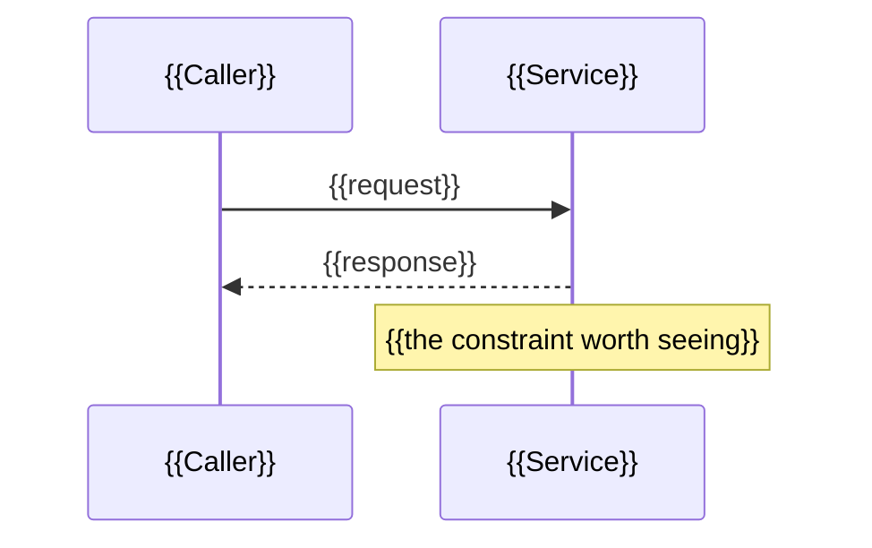

<!--
TEMPLATE: technical-design.md
Role in the pipeline: the technical plan. Records the approach, the design
decisions as ADR-style notes, the governance check against all of
governance/, and the independent work units. On a quick fix or hotfix, the plan stage
collapses to a one-line note in delivery-approach.md and this file is not written; on
a spike it collapses to a timebox sketch in delivery-approach.md. On the regular approach this is a
real file; on full-approach scale work it is paired with distribution-map.md.

The governance check here is run by the `governance-check` skill. How to
choose and write the sections below is the `plan-authoring` skill.

THE SECTIONS MARKED OPTIONAL (Summary, Interaction, Structure, Design patterns
invoked, The shape of the change and Cross-cutting concerns) EXIST so a reviewer can *see* the shape
of a change before it is built - an interaction, a structure, a named pattern,
the shape of a key type. Used well they replace paragraphs of prose. Used
badly they are padding, and a padded plan is read less carefully than a short
one. Each carries its own rule for when it earns a place; follow the rule
rather than filling every heading. Delete the ones you do not use - an empty
optional section is worse than an absent one.

Roughly: a quick fix writes no technical-design.md at all; the regular approach uses the one or two that
add clarity; full-approach scale work may use all of them, because there this file IS the
design document.

Fill every {{PLACEHOLDER}} in the sections you keep.
-->

# Plan - {{ISSUE_SLUG}}

<!-- compass:render document-header -->
<!-- /compass:render -->

---

## Summary
<!-- compass:optional -->

<!-- OPTIONAL, and the one most often worth keeping. Include when a reader
     who did not write this plan needs to know what it delivers before
     judging how. Omit on a plan short enough that the Approach already is the
     summary - restating three paragraphs in three paragraphs helps nobody.

     Three fields, same shape and same reason as the Summary in
     acceptance-criteria.md: a reader who has learned where to find it in one
     artifact finds it in the same place in the other. This is the
     write-for-a-cold-reader strategy applied to the design. -->

**Goal:** {{One sentence - what this change delivers, in user terms.}}

**Approach:** {{Two to three sentences - the shape of the change. Enough that
a reader can predict what the work units at the end will be.}}

**Why now / what changes:** {{One short paragraph - what is visibly different
afterwards, and for whom. If nothing observable changes, say so and say what
does.}}

---

## Approach

<!-- The technical approach in a few paragraphs. How the scenarios in
     acceptance-criteria.md get satisfied. What changes, where, in what order. -->

{{APPROACH}}

---

## Interaction - sequence diagram
<!-- compass:optional -->

<!-- OPTIONAL. Include when the change touches two or more collaborating
     components and the order of their exchanges matters. Omit for a change
     inside a single component - a sequence diagram of one participant
     talking to itself is noise.

     Mermaid renders natively in GitHub and every modern IDE viewer, so it is
     the default. Reach for PlantUML only when Mermaid cannot
     express the shape - component-with-lifelines, state charts with guards,
     deployment orchestration. -->



{{One or two lines on what the diagram shows that the prose does not - usually
the failure path, or the step where ordering constrains the design.}}

---

## Structure - what talks to what
<!-- compass:optional -->

<!-- OPTIONAL. Include when introducing new components, changing the
     relationships between existing ones, or spelling out a module or class
     contract the work units assume. Omit when the change adds no new
     boundary - a diagram of code that already exists, unchanged, teaches
     nothing.

     Mermaid classDiagram covers most needs; use PlantUML only where Mermaid
     cannot express what you need. -->

```mermaid
classDiagram
    class {{Interface}} {
        <<interface>>
        +{{method}}() {{Result}}
    }
    class {{Implementation}}
    {{Interface}} <|-- {{Implementation}}
```

{{What the structure commits you to, and what it deliberately leaves open.}}

---

## Design patterns invoked
<!-- compass:optional -->

<!-- OPTIONAL, and the easiest optional section to misuse. Include ONLY when a
     real, named pattern is being applied - a GoF pattern, a DDD
     pattern, a named architectural style. If you cannot name the pattern, do
     not invoke this section; and if you can name it but cannot say what it
     buys *this* change, omit it too.

     Each entry needs a reason. A pattern name with no reason is
     name-dropping: it makes a plan sound considered without making it
     clearer, and a reviewer cannot disagree with a bare name. Two justified
     patterns beat five decorative ones. Where a real choice existed, name
     the pattern you rejected and why - the named-patterns strategy,
     `S16`. -->

> - **{{Pattern name}}** ({{GoF / DDD / architectural}}) - {{what it does
>   here}}. Worth using because {{the concrete reason - an existing
>   variant, a boundary you mock, a change you expect}}.
> - **{{Pattern name}}** - {{…}}. Worth using because {{…}}.

---

## The shape of the change
<!-- compass:optional -->

<!-- OPTIONAL. Include when the shape of an interface, a type, or an API is
     itself a design decision a reviewer should be able to argue with before
     it is built. Omit when the shape is obvious from the Approach, and omit when
     you find yourself writing the implementation - this is a sketch of the
     contract, not the work. The implement stage writes the code.

     Show the signature and the boundary; leave the body as `...` unless the
     body IS the decision.

     On the full approach, put each unit's signatures in that unit's
     low-level design (low-level-design/<unit>.md) and keep here only the
     contract a reviewer argues with. -->

```{{language}}
{{The interface, type, or signature whose shape is the decision.}}
```

{{One or two lines on what a reviewer should push back on if they disagree.}}

---

## Cross-cutting concerns
<!-- compass:optional -->

<!-- OPTIONAL. Include when the change touches security, privacy, or the
     ability to see what it is doing in production - and say which. Design
     Docs at Google names these three as concerns of the DESIGN rather than
     as separate documents, which is why they live here and not in a folder
     of their own.

     Omit when the change touches none of them, and delete the heading with
     it. An empty optional section is worse than an absent one.

     WHEN A LABEL EARNS A DOCUMENT INSTEAD. Some of this is not optional. An
     issue whose assessment carries `auth`, `payments` or `personal-data`
     earns a full threat-model.md (RP-REQUIRE-005), and one carrying
     `migrations` earns a rollback-plan.md (RP-REQUIRE-006). Where those
     exist, this section points at them rather than repeating them - two
     copies of the same thinking drift, and the one with the scenarios
     attached is the one that gets tested. -->

**Security:** {{what an attacker gains if this is wrong, and what stops them -
or "no new surface". If a threat model was earned, link it rather than
summarising it.}}

**Privacy:** {{what personal data this touches, where it goes, and how long it
stays - or "none".}}

**Observability:** {{what tells you this is working in production, and what
tells you it is not. A metric, an alert, a log line someone will actually
read - or "the existing dashboards cover it", said deliberately.}}

**Well-architected pillars (`S15`):** {{on the regular or full approach, each pillar
the change touches - reliability, security, cost, operational excellence,
performance efficiency, sustainability - and what the design does about it.
Name only the ones it touches.}}

---

## Design decisions (ADR-style)

<!-- One block per real design decision. A decision with no alternative
     considered is usually not a decision yet. A quick fix has none of these by
     definition; if you have one, the approach was mis-sized - re-assess.
     Scope is `issue` when the decision holds for this issue only, and `project`
     when later issues must follow it too. `compass ship-commit` refuses a
     `project` decision until a record in architecture/decisions/ names it: cite
     the record's ADR id in the block, after `compass adr new` writes it. -->

### `DD-1` - {{DECISION TITLE}}

- **Scope:** {{issue \| project}}
- **Context:** {{what forced a choice}}
- **Decision:** {{what was chosen}}
- **Alternatives considered:** {{what else, and why not}}
- **Consequences:** {{what this commits us to; what it rules out}}
- **Governance tie:** {{which guardrail or engineering strategy this honours - or "n/a"}}

### `DD-2` - {{DECISION TITLE}}

- **Scope:** {{issue \| project}}
- **Context:** {{…}}
- **Decision:** {{…}}
- **Alternatives considered:** {{…}}
- **Consequences:** {{…}}
- **Governance tie:** {{…}}

---

## Data and interfaces

Declare every structure this change stores or sends, and a contract for every new verb,
endpoint and hook. `compass check` judges this section only when a changed file is a trigger
path or holds a trigger text, such as a schema file or a file that adds a command. Declare a
contract in the other cases too: a reader cannot review an interface that is not written down.

<!-- A declaration is one of three forms. Fill the ones that fit and delete the rest.
     An unfilled placeholder row does not count as a declaration. -->

**Fields.** One row for each persisted or exchanged field.

| Name | Type | Required | Meaning | Written by | Read by |
|---|---|---|---|---|---|
| {{field name}} | {{type}} | {{yes \| no}} | {{what it means}} | {{the code or person that writes it}} | {{the code that reads it}} |

**Relationships.** Use when the change adds or links record types.

```mermaid
erDiagram
    {{PARENT}} ||--o{ {{CHILD}} : {{holds}}
    {{PARENT}} {
        {{type}} {{field}}
    }
```

**Contracts.** One row for each new verb, endpoint or hook.

| Inputs | Outputs | Exit codes | Errors |
|---|---|---|---|
| {{arguments, request or event}} | {{what it returns or writes}} | {{codes and what each means}} | {{what it refuses, and the message}} |

---

## Verification plan

<!-- One row for each scenario group, or for a single scenario that needs a different kind
     of test from its group. Group is a comma-separated list of group letters and scenario
     ids. A scenario id wins over its group's row. The coverage ledger shows the Kind of
     each scenario. No check reads this table, so keep it short and true. -->

Kinds: `unit`, `integration`, `acceptance`, `judged review` and `manual`.

| Group | Kind | Fixture or environment |
|---|---|---|
| {{A}} | {{unit \| integration \| acceptance \| judged review \| manual}} | {{where the test runs and what it needs}} |

Not tested:
- {{what is not tested}} - {{the reason it is not}}

---

## Risks and dependencies

<!-- One row for each way this change can go wrong. Addressed by names the design decision,
     scenario or check that answers the risk. The dependencies block below is written by
     `compass issue render` from the issue's `depends_on` entries
     (`compass issue depends add`). Do not edit between the markers. -->

| Risk | Likelihood | Effect | Addressed by |
|---|---|---|---|
| {{what could go wrong}} | {{low \| medium \| high}} | {{what it affects if it does}} | {{the decision, scenario or check that answers it}} |

Dependencies on other issues:

<!-- compass:render dependencies -->
<!-- /compass:render -->

---

## Governance check

<!-- Run against ALL of governance/ - guardrails.md, strategies.md, and
     routing-policy.md. Not strategies-rationale.md: it holds the incidents
     behind the rules and states no rule, so it is read when one looks
     arbitrary rather than on every check. A failed guardrail here blocks the stage - fix the
     plan, do not note the violation and move on. A strategy not followed is
     a recorded judgement, not an automatic block. This is the
     `governance-check` skill's output. Keep the evidence side and the
     judgement side visibly separate. -->

| Area | Result | Evidence / note |
|---|---|---|
| Guardrails (the five defaults + project) | {{pass \| fail}} | {{e.g. "acceptance criteria stated before implementation; traceability chains designed in; coverage targets the guardrail floor"}} |
| Method strategies (defaults + project) | {{followed \| deviation recorded}} | {{e.g. "BDD + TDD apply; simplest-thing honoured. Any deviation noted with its reason."}} |
| Product strategies | {{followed \| deviation recorded \| n/a}} | {{e.g. "plan delivers intent.md's outcome; honours the product strategies in the shipped strategies or your project's strategies file, if it has one"}} |
| Voice & positioning strategies | {{followed \| deviation recorded \| n/a}} | {{n/a unless positioning.md is present; if so, claims traceable}} |
| Routing policy | {{pass \| fail}} | {{plan does not need to skip anything delivery-approach.md kept; floors honoured}} |

---

## Work units

<!-- The independent (or shared-surface) units of work. On the regular approach this is
     a short list; on full-approach scale work it becomes the input to distribution-map.md.
     Independence = disjoint code AND disjoint scenario groups.

     Low-level design: on the full approach, a link to the unit's own file,
     low-level-design/<unit>.md, registered with
     `compass issue artifact set low-level-design --unit U<n> --path ...`.
     Elsewhere, a dash. -->

| Unit | Scenario group(s) it satisfies | Code surface it touches | Independent of | Low-level design |
|---|---|---|---|---|
| U1 | {{group A - `TRC-A1`, `TRC-A2`}} | {{files / modules}} | {{U2, U3 - or "shares surface with U2"}} | {{a link to low-level-design/<unit>.md on full, or -}} |
| U2 | {{group B - `TRC-B1`}} | {{…}} | {{…}} | {{…}} |

**Parallelism assessment:** {{"U1 and U2 are genuinely independent → candidate pair/multiagent" - or "all units share surface → solo"}}

---

## Gate

<!-- The plan stage's exit checks, written by `compass issue render` from the issue's
     configuration (`compass issue template show technical-design`). An item is met by
     evidence recorded with `--meets`, a person's `compass evidence approve --check` or a
     follow-up recorded with `--defers`. A tick on this page counts for nothing. The
     shipped default lists none. -->

<!-- compass:render plan-exit -->
<!-- /compass:render -->

Next stage: **break down the work** (`/compass:breakdown`) - or straight to **implement** on solo work.
